# Architecture

The system in diagrams, from the outside in. Each diagram says what is built and what is
only designed. The answers to the assignment's questions are in [`answers.md`](answers.md)
(its first part explains the words used here), and the exact contracts in
[`decisions.md`](decisions.md). Python paths leave out `src/freight_agent/`.

1. [System context](#1-system-context): who sends events, who receives actions, which
   services the agent calls.
2. [Code layers](#2-code-layers): which part of the code may import which.
3. [One run](#3-one-run-claim-think-commit-deliver): the three steps of a run, and the outbox.
4. [The run graph](#4-the-run-graph): the LangGraph graph, its limits and its exits.
5. [Memory](#5-memory): what is stored per load, and the facility memory across loads.
6. [Load 481207, 07:00 to 08:01](#6-load-481207-0700-to-0801): the assignment's situation,
   run by run.
7. [Documents](#7-documents): an attachment from upload to the agent's action.
8. [SOP layers and selection](#8-sop-layers-and-selection): how a run gets its procedure.
9. [Evals and prompt versions](#9-evals-and-prompt-versions): scenarios, datasets,
   experiments, and prompts in the Hub.
10. [Production at 10x (designed)](#10-production-at-10x-designed): queues, workers,
    scheduler, Postgres, object store.

## 1. System context

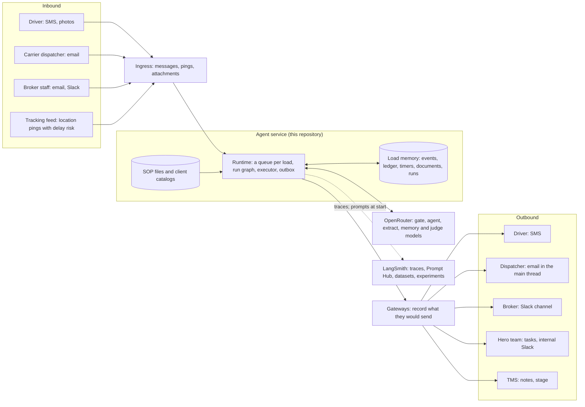

Built: the runtime; the load memory and the facility memory, in memory or in Postgres
(`PERSISTENCE`); the SOP files; the OpenRouter and LangSmith adapters; the platform (FastAPI
and a React UI), which plays every contact. Not built: real integrations (the gateways only
record what they would send) and an always-on worker.

## 2. Code layers

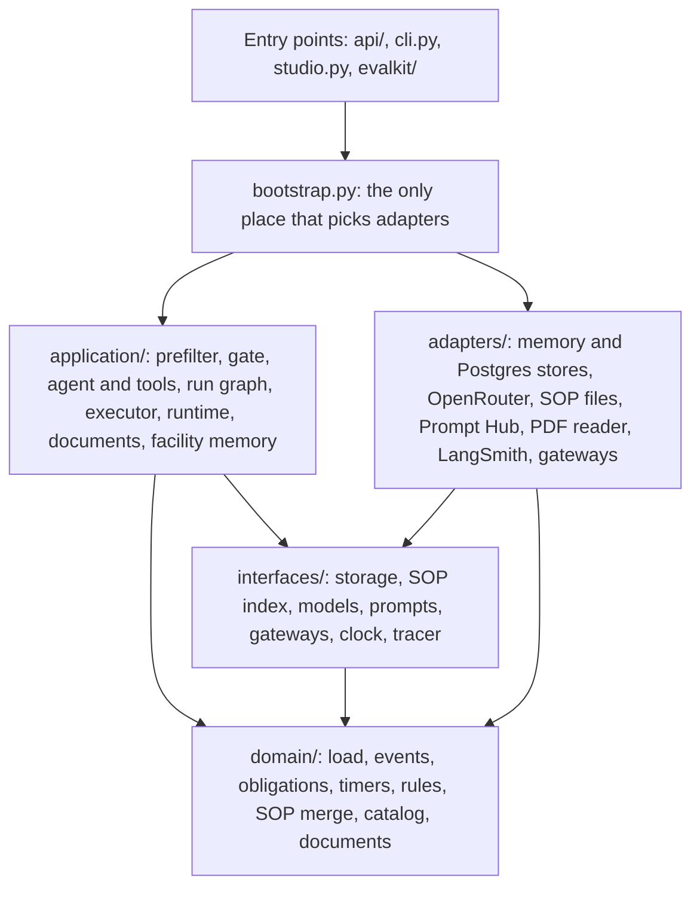

The arrows are the only imports allowed. import-linter checks them (`make arch`, five
contracts in `pyproject.toml`, also run as a unit test):

- `domain` imports nothing outside itself: no LangChain, LangGraph, FastAPI or httpx.
- `interfaces` import only the domain.
- `application` imports neither the adapters nor the API. It may import LangGraph, not
  LangChain.
- `adapters` import neither the application nor the API; `evalkit` does not import the API.
- `bootstrap.py` is the only place that wires adapters to interfaces.

LangChain is used only by the adapters (models, embeddings, prompt templates),
`bootstrap.py` and `evalkit/`. pyright runs in strict mode on `domain`, `interfaces` and
`application`.

## 3. One run: claim, think, commit, deliver

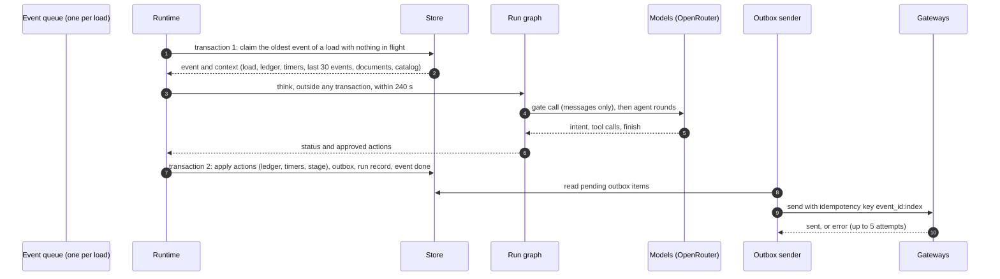

No transaction stays open while a model thinks. A run commits everything it decided or
nothing. If a worker dies after the claim, the event stays in flight until the claim lease
(the deadline plus 60 s) returns it to the queue, counted as a failed attempt. After three
failed attempts it becomes a dead letter.

## 4. The run graph

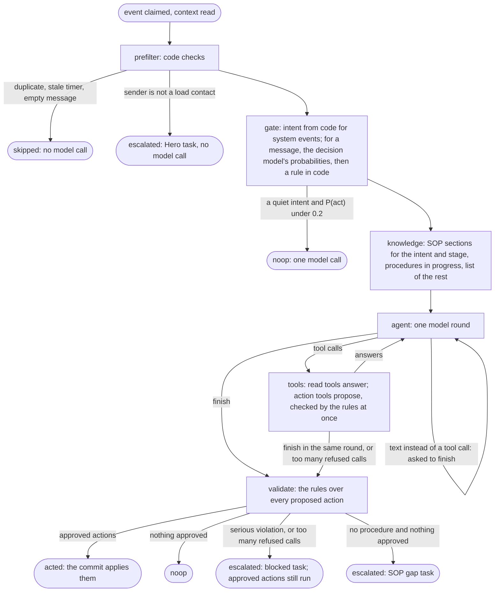

| Node | Code | Model call | Can end the run as |
|---|---|---|---|
| prefilter | `application/prefilter.py` | none | `skipped` (duplicate, stale timer, empty message); `escalated` (unknown sender) |
| gate | `application/gate_decision.py` (`application/gate.py` with `GATE_ENGINE=llm`) | messages only: one call to TypeSafe's Jev 1.14 (GPT-4.1 Nano with `llm`); system events get their intent from code | `noop`: an intent that may end a run, such as an acknowledgement, with P(needs the agent now) under 0.2 |
| knowledge | `application/graph/nodes.py` | none | never |
| agent, tools | `application/agent.py`, `application/agent_tools.py` | one call per round, gpt-oss-120b | goes on to validate |
| validate | `domain/validation.py`, `domain/rules.py` | none | `acted`, `noop`, `escalated` |

| Limit | Default | Where | When it is reached |
|---|---|---|---|
| `max_steps` | 8 rounds | `BrokerLimits`, per client | The next round must call `finish` |
| `max_cost_usd` | $0.05 per run | `BrokerLimits` | The next round must call `finish` |
| `max_rejections` | 3 refused action calls | `BrokerLimits` | The run stops and escalates; accepted actions still run |
| Model timeout | 60 s per round, its retries included | `RuntimeConfig.llm_timeout_s` | The call moves to the next model of the role |
| Rate limit or overloaded provider | 2 retries on the same model, about 1 s then 2 s apart | `RetryPolicy`, `adapters/llm/resilient.py` | The call moves to the next model of the role |
| Run deadline | 240 s | `RuntimeConfig.run_deadline_s` | The run escalates with one urgent Hero task; the event is done |
| Model failure | after the retries and the fallbacks | `adapters/llm/resilient.py` | The run escalates with one urgent Hero task; the event is done |

The graph is `application/graph/build.py`. The platform draws the same graph from
`GET /api/graph`, and LangGraph Studio shows it inside its scenario graph.

## 5. Memory

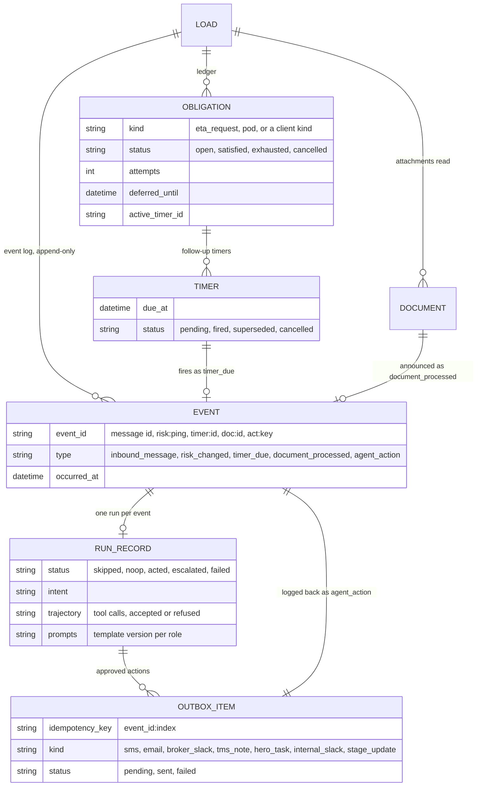

Every run reads one snapshot of this memory (`application/context.py`) and keeps nothing in
the process between runs. The agent's own actions come back as `agent_action` events, so the
next run reads what was sent, to whom and when.

`PERSISTENCE` chooses where the memory lives, behind the interfaces of
`interfaces/repositories.py`: in the process (`adapters/persistence/memory/`; the default,
and always in tests, evals and Studio), or in Postgres (`adapters/persistence/postgres/`;
the Docker Compose platform), one table per entity above, plus `risk_trackers` and
`event_queue` (`migrations/`). Both stores pass the same contract tests. Transactions and
locks are in [decisions.md, Storage](decisions.md#storage).

### Facility memory, across loads

The memory above ends with its load. Facility notes outlive it: what a driver says about a
pickup or delivery place is kept for the next load of the same client there.

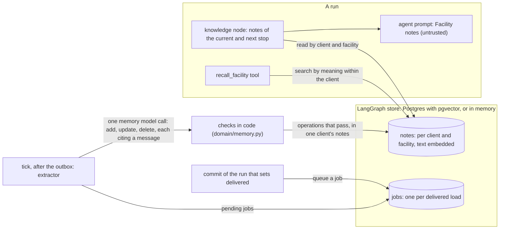

- A note is one short text with a kind (`check_in`, `hours`, `requirement`, `access`,
  `contact`, `other`), its facility (the stop's normalized name and address), its client,
  and its source: the load, the message and when it was said.
- Each note's text is embedded (turned into numbers that stand for its meaning) with
  `openai/text-embedding-3-small` on OpenRouter, or with an offline hash when there is no
  key and in the tests. The store is any LangGraph store (`adapters/memory/store.py`): on
  Postgres, LangGraph's Postgres store in the load memory's database, with a pgvector index
  (`adapters/memory/postgres.py`); otherwise an in-memory store with the same index.
- A job is queued after the delivering run's commit. If the process crashes in between, the
  platform queues the job again when it starts on Postgres
  (`AgentRuntime.queue_missed_extractions`).

## 6. Load 481207, 07:00 to 08:01

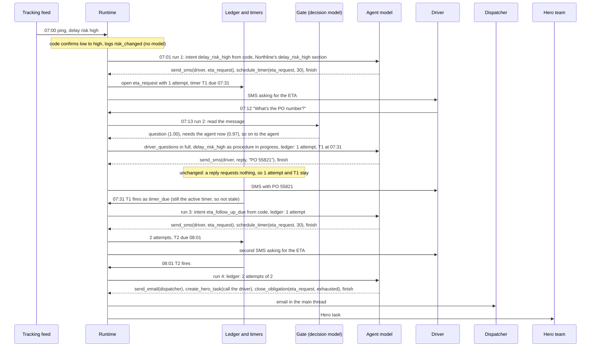

In the evals and on the platform, the run of an injected event happens 60 s after it, and
timers fire with no delay. So the 08:02 actions of the assignment's table happen at 08:01
here. The scenario is `evals/scenarios/core/a_client_a_high_risk.yaml`.

## 7. Documents

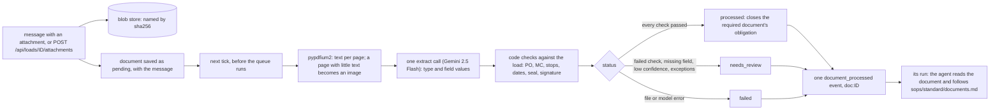

The message's own run never acts on the attachment; only the `document_processed` run does,
so a document is handled once. Code: `application/documents.py`, `domain/documents.py`,
`adapters/documents/pdfium.py`.

## 8. SOP layers and selection

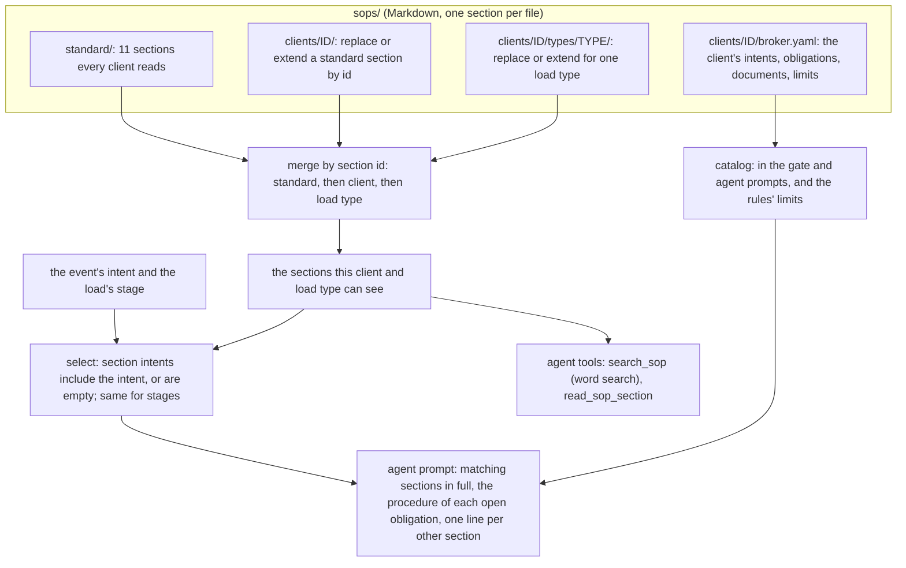

A client folder holds only what the client changes. Another client's sections are never
visible. A hash of the whole folder is recorded with every run as the SOP version.

## 9. Evals and prompt versions

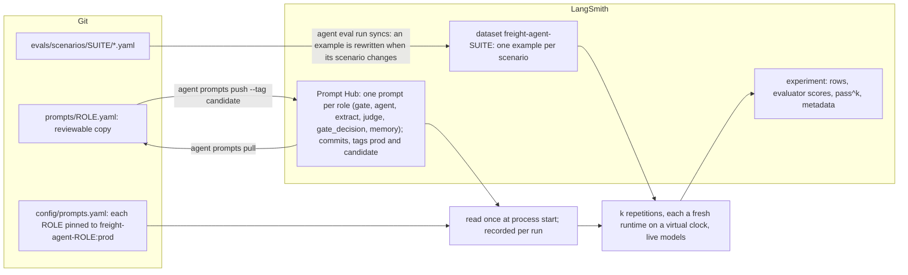

An experiment's metadata names the git commit, the model of each role, the prompt version of
each role and the SOP hash. To promote a prompt: edit it, `push --tag candidate`,
`agent eval run --prompt-tag candidate`, compare in LangSmith, `push --tag prod`, restart.

## 10. Production at 10x (designed)

Not built, except Postgres, which the platform already runs on. The interfaces stay the
same; the adapters behind them change.

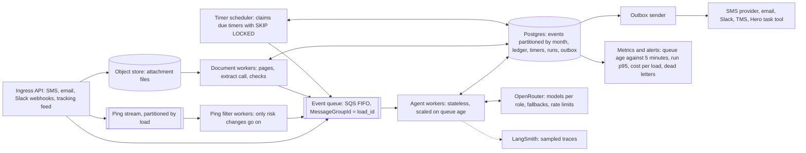

Sizing and the reason for each part are in
[`answers.md`, 5.2](answers.md#52-volume-x10-what-must-change). An earlier build of the
pgvector search and the operational metrics is at the git tag `full-platform`.
