<!-- generated-by: gsd-doc-writer -->
# Architecture

The system in diagrams, from the outside in. Each diagram says what is built and what is
only designed. The answers to the assignment's questions are in [`answers.md`](answers.md)
(its first part explains the words used here), and the exact contracts in
[`decisions.md`](decisions.md). Python paths leave out `src/freight_agent/`.

1. [System context](#1-system-context): who sends events, who receives actions, which
   services the agent calls.
2. [Code layers](#2-code-layers): which part of the code may import which.
3. [One run](#3-one-run-claim-think-commit-deliver): claim, think, commit and delivery in Activities.
4. [The run graph](#4-the-run-graph): the LangGraph graph, its limits and its exits.
5. [Memory](#5-memory): business state, grounded context and facility memory across loads.
6. [Load 481207, 07:00 to 08:01](#6-load-481207-0700-to-0801): the assignment's situation,
   run by run.
7. [Documents](#7-documents): an attachment from upload to the agent's action.
8. [SOP layers and selection](#8-sop-layers-and-selection): profile lifecycle and runtime selection.
9. [Evals and prompt versions](#9-evals-and-prompt-versions): scenarios, datasets,
   experiments, and prompts in the Hub.
10. [Durable execution and production at 10x](#10-durable-execution-and-production-at-10x):
    the implemented Temporal loop and the remaining production work.
11. [Code map](#11-code-map): the main abstractions and directory responsibilities.

The live path is the default in these diagrams. The assignment timeline in section 6
and the eval player in section 9 explicitly use virtual time. Arrows are labeled where
the distinction between calls, data and recovery matters. Operational stop means the
pickup/delivery facility; stopping execution means an operator halts automation.

## 1. System context

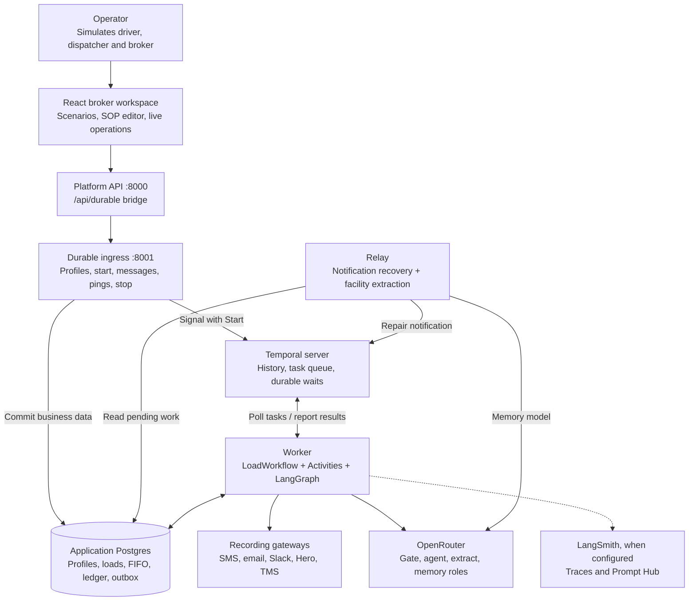

Built: the runtime; load and facility memory in memory or Postgres (`PERSISTENCE`);
OpenRouter and LangSmith adapters; and the React broker workspace. Live operations use
one Temporal workflow per load, a worker and a notification relay, with a real clock and
their own Postgres database. The workspace seeds Northline, Keystone, Aurora and Acme,
persists editable broker SOP profiles, pins a snapshot for each execution, and lets an
operator send contact messages, inject location pings and stop an execution. The CLI eval
player and Studio retain their virtual-clock execution path.
External SMS, email, Slack, Hero and TMS providers are still recording gateways; live
operation means real model calls and durable scheduling, not delivery to real contacts.

The worker executes Workflow and Activity code; the Temporal server stores orchestration
history and dispatches tasks. The UI polls the durable API for business snapshots through
the bridge. Physical services, ports and storage volumes are shown in
[the Temporal deployment diagram](temporal.md#local-service-topology).

## 2. Code layers

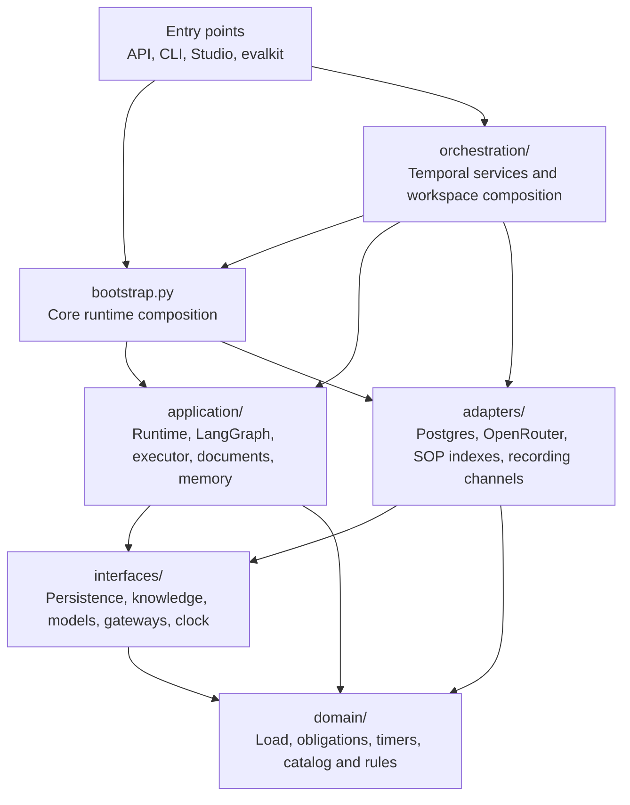

These are the core dependency directions. import-linter checks them (`make arch`, five
contracts in `pyproject.toml`, also run as a unit test):

- `domain` imports nothing outside itself: no LangChain, LangGraph, FastAPI or httpx.
- `interfaces` import only the domain.
- `application` imports neither the adapters nor the API. It may import LangGraph, not
  LangChain.
- `adapters` import neither the application nor the API; `evalkit` does not import the API.
- `bootstrap.py` wires the core runtime; `orchestration/worker.py` composes its real-clock
  Postgres dependencies with Temporal. The workspace also uses the Postgres profile adapter.

LangChain integrations are kept outside the domain and application. pyright runs in strict mode on `domain`, `interfaces` and
`application`.

## 3. One run: claim, think, commit, deliver

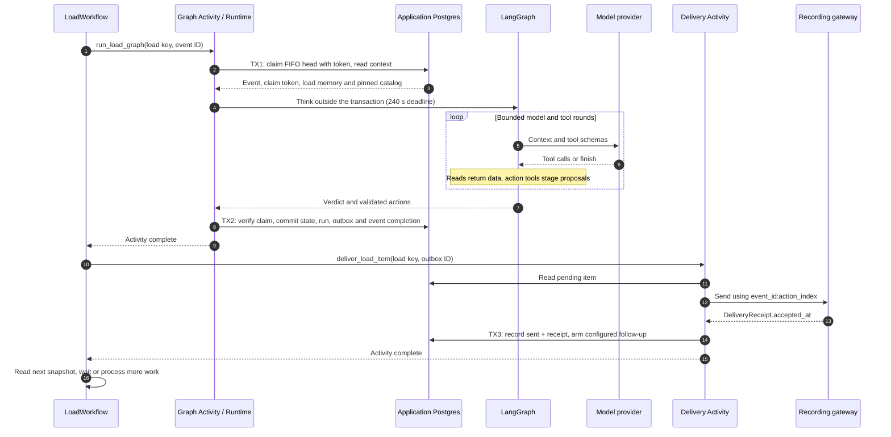

No transaction stays open while a model thinks. Applicable approved actions, the run record
and completion commit atomically; domain-invariant failures are recorded as skipped
actions. If a worker dies after the claim, the event stays in flight until the claim lease
(the deadline plus 60 s) returns it to the queue, counted as a failed attempt. After three
failed attempts it becomes a dead letter.

Claims carry a fencing token: an expired Activity attempt cannot commit state or release
its replacement's claim. In durable mode (`delivery_followups=True`), an ETA request's
follow-up timer is armed after the gateway accepts the outbox item, not when the model
proposes it. Activity retries can replay sends: stable idempotency keys and a deduplicating
gateway are required to prevent duplicate external effects. The recording gateway
deduplicates within its process; no persistent production provider adapter has been
validated yet.

## 4. The run graph

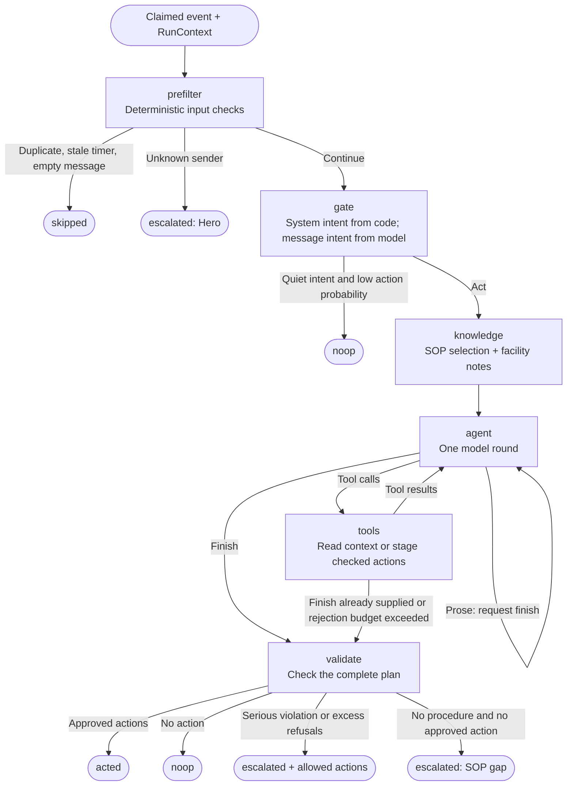

| Node | Code | Model call | Can end the run as |
|---|---|---|---|
| prefilter | `application/prefilter.py` | none | `skipped` (duplicate, stale timer, empty message); `escalated` (unknown sender) |
| gate | `application/gate_decision.py` (`application/gate.py` with `GATE_ENGINE=llm`) | messages only: one call to TypeSafe's Jev 1.14 (GPT-4.1 Nano with `llm`); system events get their intent from code | `noop`: an intent that may end a run, such as an acknowledgement, with P(needs the agent now) under 0.2 |
| knowledge | `application/graph/nodes.py` | none | never |
| agent, tools | `application/agent.py`, `application/agent_tools.py` | one call per round, gpt-oss-120b | goes on to validate |
| validate | `domain/validation.py`, `domain/rules.py` | none | `acted`, `noop`, `escalated` |

| Limit | Default | Where | When it is reached |
|---|---|---|---|
| `max_steps` | 8 rounds | `BrokerLimits`, per client | The next round must call `finish` |
| `max_cost_usd` | $0.05 per run | `BrokerLimits` | The next round must call `finish` |
| `max_rejections` | 3 refused action calls | `BrokerLimits` | The run stops and escalates; accepted actions still run |
| Model timeout | 60 s per round, its retries included | `RuntimeConfig.llm_timeout_s` | The call moves to the next model of the role |
| Rate limit or overloaded provider | 2 retries on the same model, about 1 s then 2 s apart | `RetryPolicy`, `adapters/llm/resilient.py` | The call moves to the next model of the role |
| Run deadline | 240 s | `RuntimeConfig.run_deadline_s` | The run escalates with one urgent Hero task; the event is done |
| Model failure | after the retries and the fallbacks | `adapters/llm/resilient.py` | The run escalates with one urgent Hero task; the event is done |

The graph is `application/graph/build.py`. This is a bounded ReAct-style tool loop:
model rounds consume tool results; action tools only stage proposals. The executor and
outbox apply approved actions after validation. LangGraph Studio nests the graph in its
scenario graph. The current
live workspace shows run decisions and tool trajectories rather than that graph viewer.

## 5. Memory

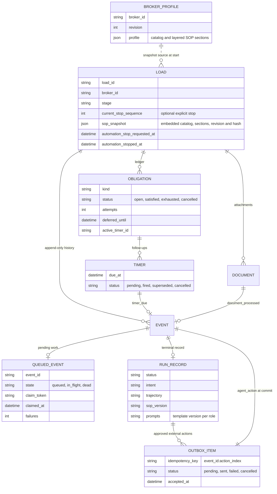

This is a logical view, not a list of SQL foreign keys. The SOP snapshot and stop fields
are embedded in the load metadata; `QUEUED_EVENT` is the `event_queue` table. Profiles
hold the latest editable revision, while each load retains its own frozen copy. Temporal's
execution history is a separate store; it does not replace this business memory.

### Context and the operational stop

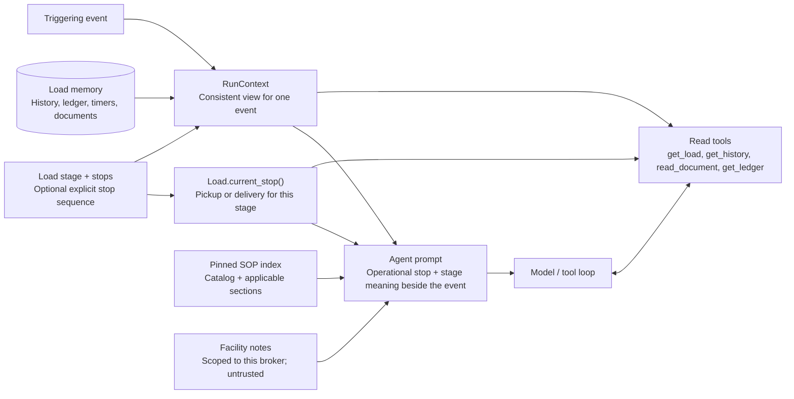

Every run rebuilds its context from this memory (`application/context.py`); the standalone
run graph does not require a LangGraph conversation checkpointer. Temporal resumes the
orchestration, while Postgres supplies business context for the next run. The agent's own
actions come back as `agent_action` events, so the next run reads what was approved, to
whom and when. The outbox status and `accepted_at`
separately establish whether a gateway accepted the action.

The load also carries its immutable `sop_snapshot`, the profile revision, and stop-requested
and stopped timestamps. Editable profiles live in `broker_profiles`; they are not the
per-run conversation memory. A saved profile changes subsequent loads, not existing snapshots.

`Load.current_stop()` resolves the operational stop from an explicit sequence when set,
otherwise from the stage: pickup for `dispatched`, `to_pickup`, `at_pickup`; delivery for
`to_delivery`, `at_delivery`, `delivered`. `application/prompts.py` includes this fact in
the load context, beside the triggering event and in `get_load`. It distinguishes a
future arrival, an already reached facility and a completed delivery. This grounding
applies to local and Hub templates and to older pinned SOPs; it is prompt guidance,
not a deterministic validator of every facility name in generated prose.

`PERSISTENCE` chooses where the load memory lives, behind the interfaces of
`interfaces/repositories.py`: in the process (`adapters/persistence/memory/`; the default,
and in isolated eval/Studio plays), or in Postgres (`adapters/persistence/postgres/`;
the Docker Compose services and database tests). The SQL schema is in `migrations/`,
including `event_queue` and `risk_trackers`. Both load-memory stores pass the same contract
tests. Editable broker profiles use a separate Postgres workspace repository. Transactions
and locks are in [decisions.md, Storage](decisions.md#storage).

### Facility memory, across loads

The memory above is scoped to a load. Facility notes are reusable across loads: what a
driver says about a pickup or delivery place is kept for the next load of the same client
there.

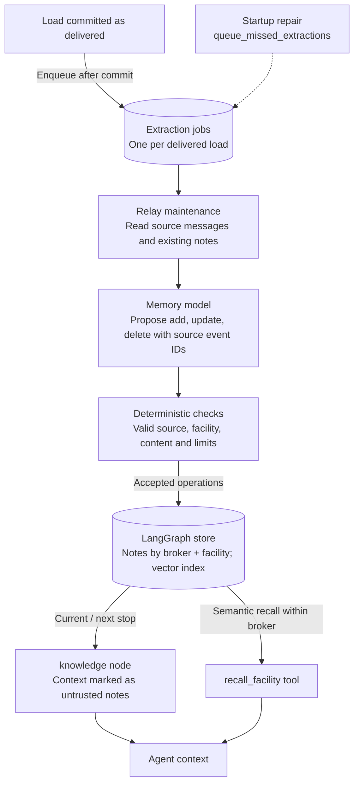

- A note is one short text with a kind (`check_in`, `hours`, `requirement`, `access`,
  `contact`, `other`), its facility (the stop's normalized name and address), its client,
  and its source: the load, the message and when it was said.
- Each note's text is embedded (turned into numbers that stand for its meaning) with
  `openai/text-embedding-3-small` on OpenRouter, or with an offline hash when there is no
  key and in the tests. The store is any LangGraph store (`adapters/memory/store.py`): on
  Postgres, LangGraph's Postgres store in the load memory's database, with a pgvector index
  (`adapters/memory/postgres.py`); otherwise an in-memory store with the same index.
- A job is queued after the delivering run's commit. If the process crashes in between, the
  durable relay queues the job again when it starts on Postgres
  (`AgentRuntime.queue_missed_extractions`).

## 6. Load 481207, 07:00 to 08:01

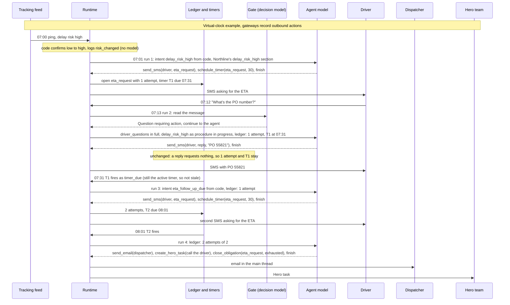

This diagram shows `evals/scenarios/core/a_client_a_high_risk.yaml` on the virtual-clock
player: an injected event runs 60 simulated seconds after it, and timers fire without
simulated delay. In the live workspace, the initial ping is sent immediately, model
latency is real, and the 30-minute wait begins when the gateway accepts the SMS. A durable
timer makes the work eligible at the deadline; worker availability, queue order and model
latency determine when the resulting action is actually accepted.

## 7. Documents

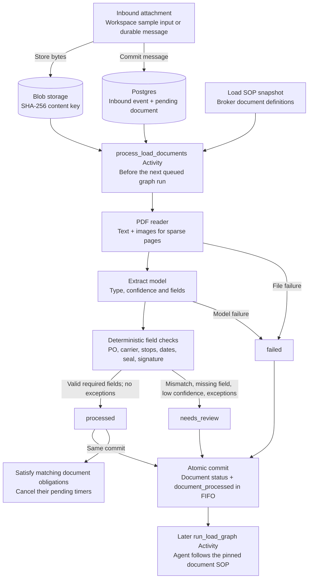

The document SOP directs the message's run to defer attachment handling to the
`document_processed` event. Persistence makes that event idempotent; a database failure
can retry processing. A file/model failure is recorded as `failed` and announced to the
agent for escalation. The eval/Studio virtual-clock runtime runs the same pipeline in `tick()`. Code: `application/documents.py`, `domain/documents.py`,
`adapters/documents/pdfium.py`.

## 8. SOP layers and selection

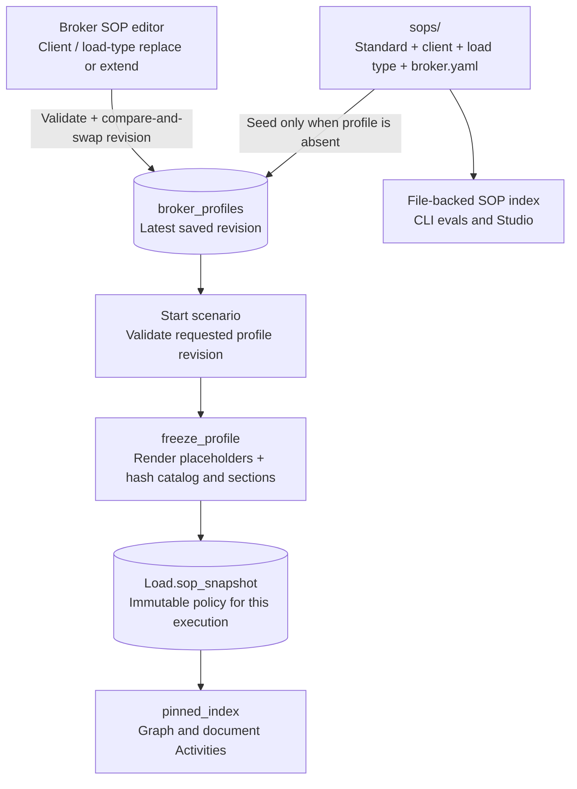

The editor's standard layer is read-only. Saving a profile affects future executions;
changing a seed file does not overwrite an existing profile. CLI evals take the file path
shown above, so they do not automatically test a draft or saved workspace profile.

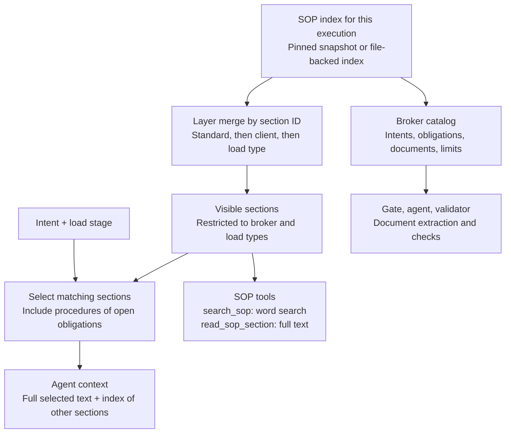

A client folder holds only what the client changes. Another client's sections are never
visible. File-backed evals record a hash of the SOP folder. The live workspace seeds a
`BrokerProfile` from those files, saves revisions in Postgres with compare-and-swap, and
freezes catalog and layered sections into the load at start. Parameters such as attempt
count, follow-up minutes and escalation channels are rendered into the snapshot before
its hash is computed. Both graph and document Activities read that pinned catalog.
The editor permits client and load-type replacements/extensions; the inherited standard
layer is read-only. Review/approval and canary rollout are not implemented.
CLI evals read the file-backed SOPs; they do not automatically evaluate saved UI profiles.
Changing a seed file also does not overwrite a profile already saved in Postgres.

## 9. Evals and prompt versions

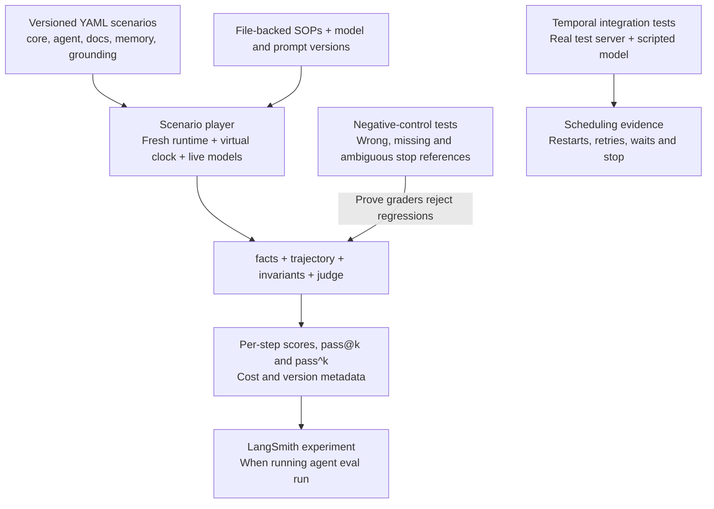

The seven grounding scenarios cover all six load stages plus pickup departure. They
require the operational facility, reject the other facility and judge whether the wording
matches an upcoming, current or completed stop. Temporal tests cover orchestration rather
than model wording. The workspace reuses scenario inputs, with manual replies and real
time; it does not run these graders.

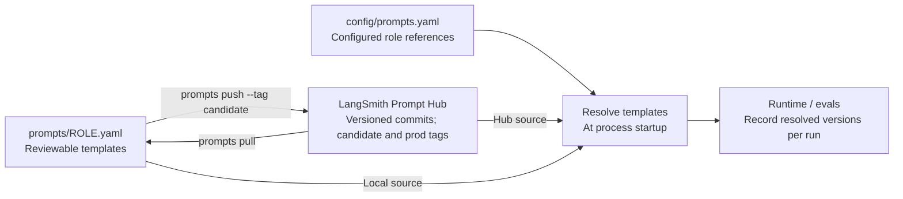

An experiment's metadata names the git commit, the model of each role, the prompt version of
each role and the SOP hash. To promote a prompt: edit it, `push --tag candidate`,
`agent eval run --prompt-tag candidate`, compare in LangSmith, `push --tag prod`, restart.

Code: `evalkit/` and `tests/evalkit/test_stop_grounding.py`; scheduling tests are in
`tests/temporal/`. See [the grounding eval](stop-grounding.md) for assertions and results.

## 10. Durable execution and production at 10x

The following loop is implemented in `orchestration/`, with a standalone local stack in
`compose.temporal.yml`. Postgres holds business state and FIFO order; Temporal holds
workflow progress and durable waits. Model calls, SQL and sends run in Activities, outside
the deterministic Workflow code.

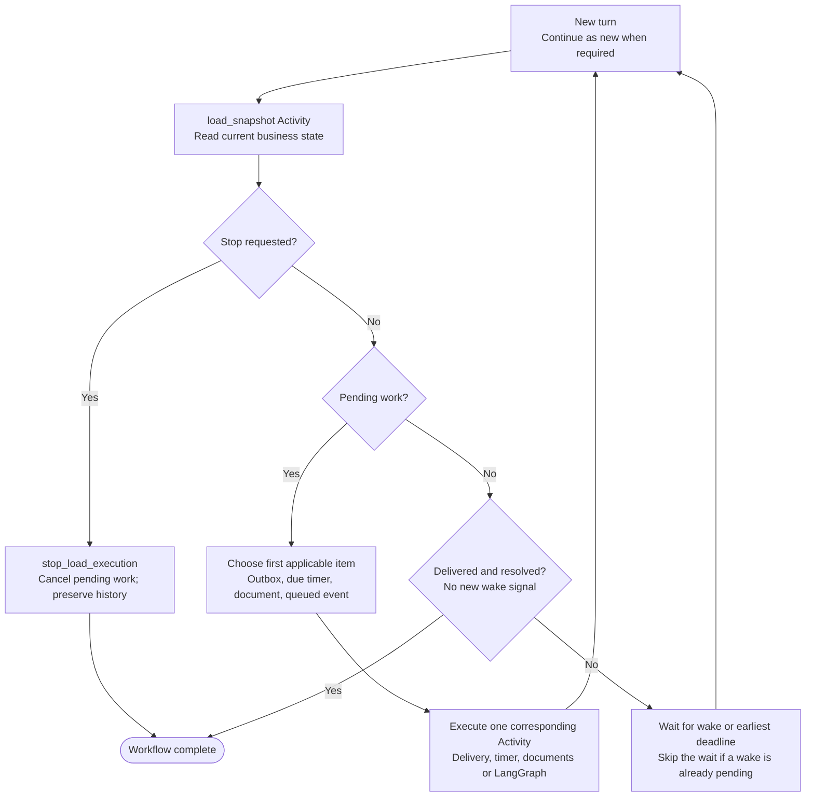

`LoadWorkflow` handles pending delivery, due timers, documents and queued graph events in
that order, then waits until a signal or the next deadline. Each Activity completes before
the next starts for this load. Snapshot errors for a dead-letter event or failed delivery
surface as non-retryable Activity failures; operator intervention is required.
It rereads state before firing,
so an ETA can cancel a pending follow-up. Signals coalesce; the persistent queue preserves
events. The relay repairs the commit-to-notification gap after a Temporal outage. Workflows
continue as new after 100 turns or when Temporal recommends it, rereading absolute
deadlines from Postgres.

Stop is cooperative: persist the request, let the current Activity settle, then cancel
pending timers, open obligations and unsent outbox items, preserve history and complete
the workflow. It cannot retract an already accepted send. The
[30-minute timer sequence](temporal.md#timer-lifecycle-30-minute-eta-follow-up) shows
receipt persistence, wakeups and cancellation in detail. New inputs to a stopping or
stopped load are rejected; continuing requires a new execution.

The local Temporal service is `start-dev` with a persistent SQLite volume, not a production
cluster. Production still needs a supported Temporal deployment, provider integrations,
operational alerts, capacity testing/autoscaling, object storage and rollout controls.
Queue age and model-provider limits must be measured; the 10x sizing in
[`answers.md`, 5.2](answers.md#52-volume-x10-what-must-change) is a capacity estimate, not a
load-test result. Hybrid SOP search and operational metrics existed in an earlier build
at the git tag `full-platform` but are not part of this runtime.

## 11. Code map

| Area / abstraction | Responsibility |
|---|---|
| `domain/` — `Load`, `Obligation`, `Timer`, `Broker`, SOP merge and action rules | Business facts and invariant checks independent of orchestration and model providers |
| `interfaces/` — `UnitOfWork`, `SopIndex`, model, prompt and gateway contracts | Boundaries the application uses without selecting infrastructure |
| `application/runtime.py` — `AgentRuntime`, `RuntimeDeps` | Ingress, fenced claim/think/commit, outbox delivery and background work |
| `application/graph/`, `agent.py`, `agent_tools.py`, `prompts.py` | Bounded tool loop, selected knowledge and grounded context |
| `adapters/` | Postgres/in-memory persistence, OpenRouter, Prompt Hub, SOP files, document readers and recording channels |
| `orchestration/` — `LoadWorkflow`, `LoadActivities`, `TemporalIngress`, `BrokerProfile` | Durable scheduling, real-clock composition, profile editing and execution snapshots |
| `api/`, `web/src/` | Main FastAPI service/proxy and broker workspace UI |
| `evalkit/`, repository `evals/` and `tests/` | Scenario execution/graders, fixtures and deterministic/Temporal verification |

This split keeps the same agent runtime usable in fast virtual-clock evals and durable
live operations while isolating infrastructure and UI concerns.
