# Architecture

The system in diagrams, from the outside in. Each diagram says what is built and what is
only designed. The answers to the assignment's questions are in
[`answers.md`](answers.md); the contracts every part follows are in
[`decisions.md`](decisions.md). Python paths below leave out `src/freight_agent/`.

| Diagram | Shows |
|---|---|
| [1. System context](#1-system-context) | Who sends events, who receives actions, which services the agent calls |
| [2. Code layers](#2-code-layers) | Domain, interfaces, application, adapters, and who may import whom |
| [3. One run](#3-one-run-claim-think-commit-deliver) | The three phases of a run and the outbox |
| [4. The run graph](#4-the-run-graph) | The LangGraph graph, its budgets and its exits |
| [5. Memory](#5-memory) | Event log, ledger, timers, outbox, documents, run records |
| [6. Load 481207, 07:00 to 08:01](#6-load-481207-0700-to-0801) | The assignment's situation, run by run |
| [7. Documents](#7-documents) | An attachment from upload to the agent's action |
| [8. SOP layers and selection](#8-sop-layers-and-selection) | How a run gets its procedure |
| [9. Evals and prompt versions](#9-evals-and-prompt-versions) | Scenarios to datasets to experiments; prompts in the Hub |
| [10. Production at 10x (designed)](#10-production-at-10x-designed) | Queues, workers, scheduler, Postgres, object store |

## 1. System context

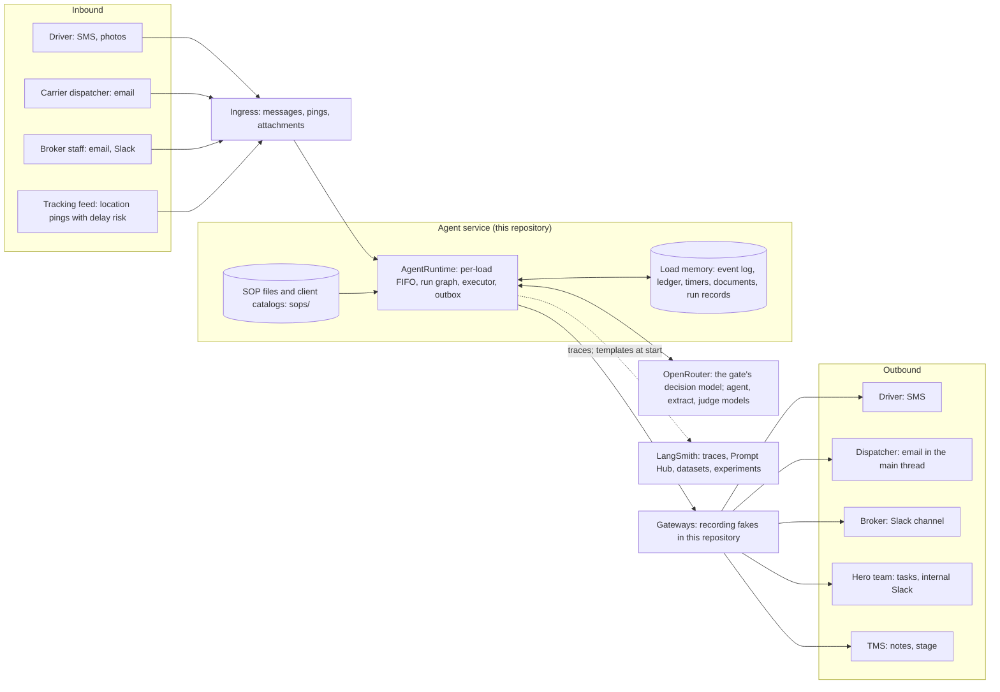

Built: the runtime, the load memory in memory or in Postgres (`PERSISTENCE`), the SOP
files, the OpenRouter and LangSmith adapters, the platform (FastAPI and a React UI) that
plays every contact. Not built: real integrations (the gateways record what they would
send), an always-on worker.

## 2. Code layers

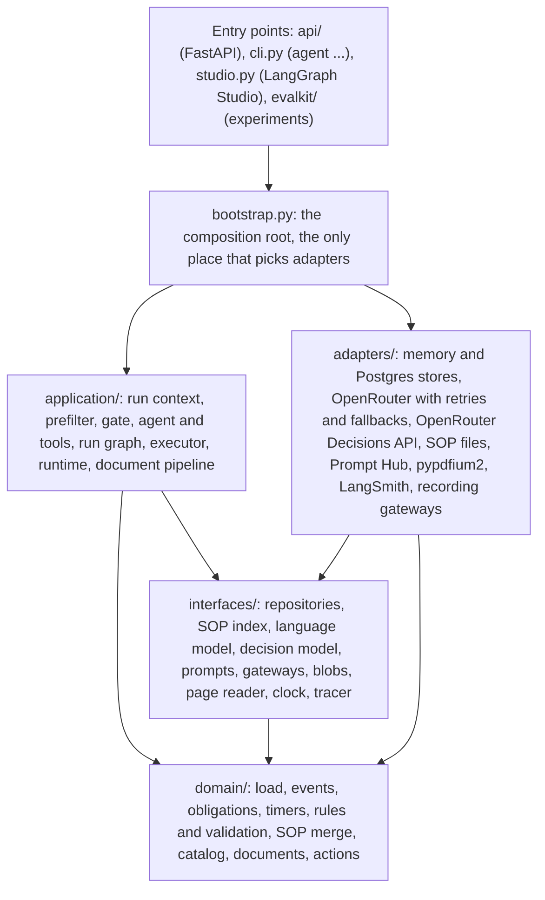

The arrows are the only imports allowed. import-linter enforces them (`make arch`, five
contracts in `pyproject.toml`), pyright runs in strict mode on `domain`, `interfaces` and
`application`, and LangChain is imported only in `adapters/llm`.

## 3. One run: claim, think, commit, deliver

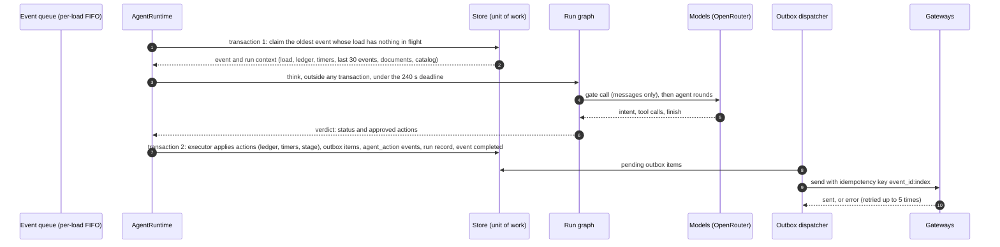

No transaction stays open while a model thinks. A run either commits everything it
decided or nothing. A worker that dies after the claim leaves the event in flight; the
claim lease (deadline plus 60 s) returns it to the queue, counted as a failed attempt;
three failed attempts make it a dead letter.

## 4. The run graph

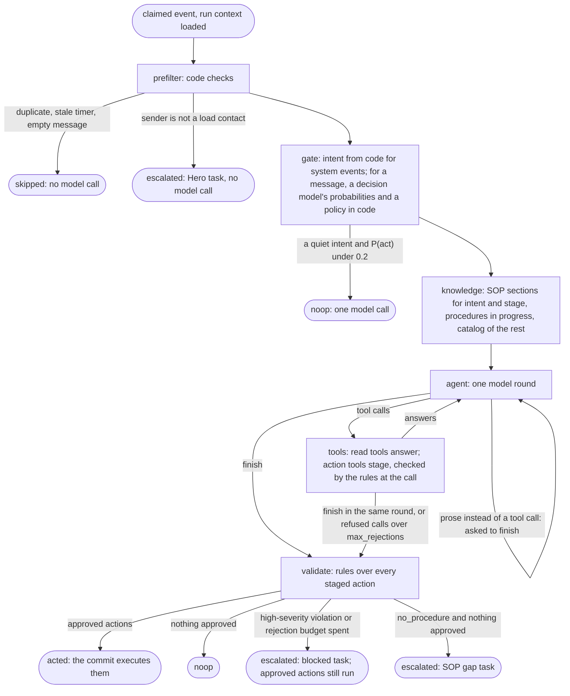

| Budget | Default | Where | When it is spent |
|---|---|---|---|
| `max_steps` | 8 rounds | `BrokerLimits`, per client | The next round must call `finish` (the tool choice forces it) |
| `max_cost_usd` | $0.05 per run | `BrokerLimits` | The next round must call `finish` |
| `max_rejections` | 3 refused action calls | `BrokerLimits` | The run stops and escalates; accepted actions still run |
| Model timeout | 60 s per round, its retries included | `RuntimeConfig.llm_timeout_s` | The call fails over to the next model of the role |
| Rate limit or overloaded provider | 2 retries on the same model, about 1 s then 2 s apart | `RetryPolicy`, `adapters/llm/resilient.py` | The call fails over to the next model of the role |
| Run deadline | 240 s | `RuntimeConfig.run_deadline_s` | The run escalates with one urgent Hero task; the event completes |
| Model failure | after the retries and the fallbacks | `adapters/llm/resilient.py` | The run escalates with one urgent Hero task; the event completes |

The graph is `application/graph/build.py`; the platform draws the same graph from
`GET /api/graph`, and LangGraph Studio shows it inside its scenario graph.

## 5. Memory

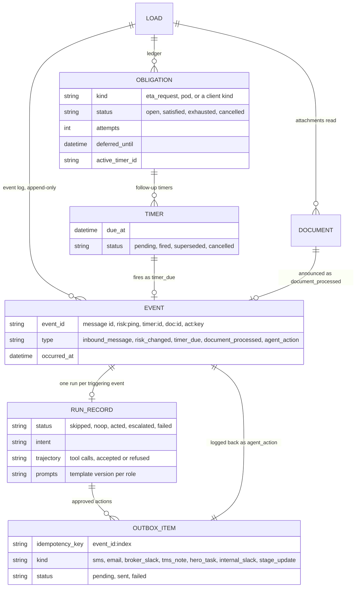

Every run reads one snapshot of this memory (`application/context.py`); it never relies
on anything kept in the process between runs. The agent's own actions come back as
`agent_action` events, so the next run reads what was sent, to whom and when.

The memory lives in the store `PERSISTENCE` names, behind the interfaces of
`interfaces/repositories.py`: in the process (`adapters/persistence/memory/`, the default,
the tests, the evals and Studio, each play in a fresh world), or in Postgres
(`adapters/persistence/postgres/`, the Docker Compose platform), one table per entity of
the diagram plus `risk_trackers` and `event_queue` (`migrations/`, applied by
`agent db migrate`). A unit of work is one transaction; the queue claim and the due
timers skip rows another worker holds (`FOR UPDATE SKIP LOCKED`); a partial unique index
allows one event in flight per load. Both stores pass the same contract suites.

### Facility memory, across loads

The memory above ends with its load. Facility notes outlive it: what a driver learns about
a pickup or a delivery place is kept for the next load of the same client at that place.

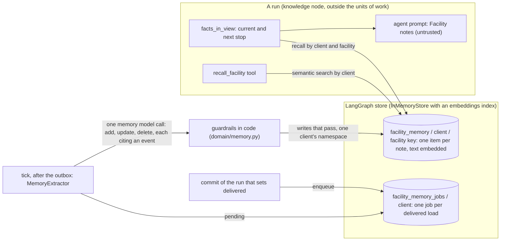

- A note (`FacilityFact`) is one short text with a kind (`check_in`, `hours`,
  `requirement`, `access`, `contact`, `other`), its facility (`facility_key`: the stop's
  normalized name and address), its client, and its source: the load, the inbound event and
  when it was said.
- Embeddings: `openai/text-embedding-3-small` on OpenRouter (`embeddings.memory` in
  `config/models.yaml`), or a deterministic offline hash without the key and in the tests.
- The store is any LangGraph `BaseStore` (`adapters/memory/store.py`); a `PostgresStore`
  with pgvector takes the same namespaces.

## 6. Load 481207, 07:00 to 08:01

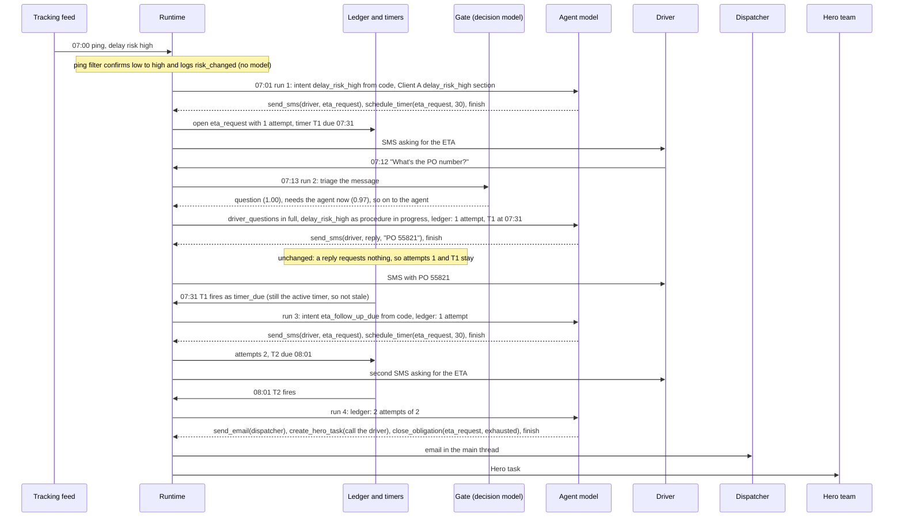

Runs of injected events happen 60 s after the event in the evals and on the platform;
timers fire with zero latency, so the 08:02 actions of the assignment's table happen at
08:01 here. The scenario is `evals/scenarios/core/a_client_a_high_risk.yaml`.

## 7. Documents

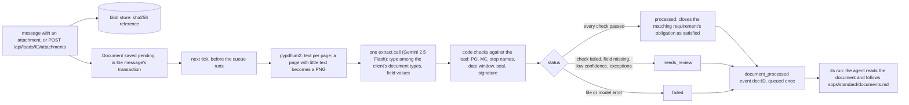

The message's own run never acts on the attachment; only the `document_processed` run
does, so a document is handled once. Code: `application/documents.py`,
`domain/documents.py`, `adapters/documents/pdfium.py`.

## 8. SOP layers and selection

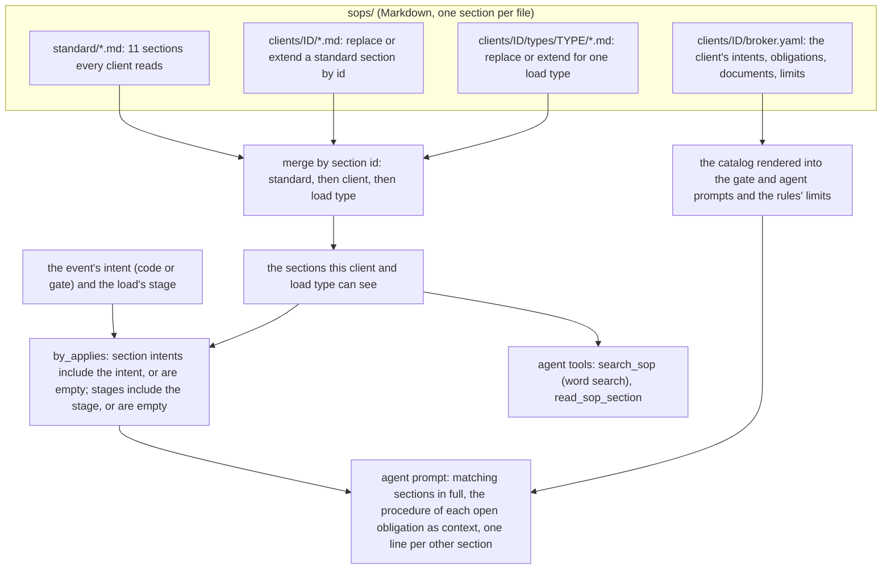

A client folder holds only what the client changes. Another client's sections are never
visible. The tree's content hash is recorded with every run as `sop_version`.

## 9. Evals and prompt versions

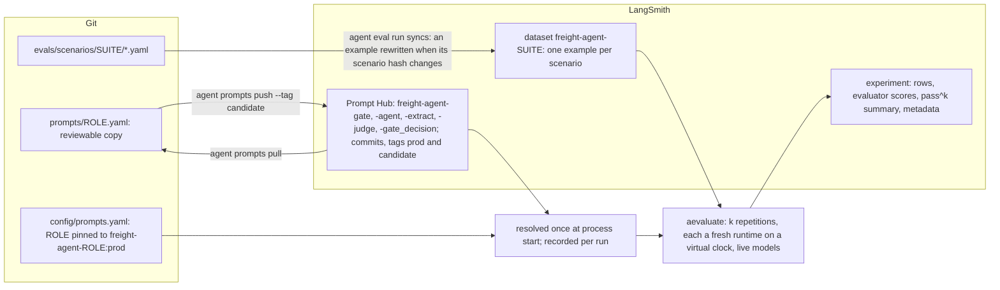

An experiment's metadata names the git sha, the model of each role, the prompt commit of
each role and the SOP hash. Promotion of a prompt: edit, `push --tag candidate`,
`agent eval run --prompt-tag candidate`, compare in LangSmith, `push --tag prod`, restart.

## 10. Production at 10x (designed)

Not built, except Postgres, which the platform already runs on. The interfaces stay the
same; the adapters behind them change.

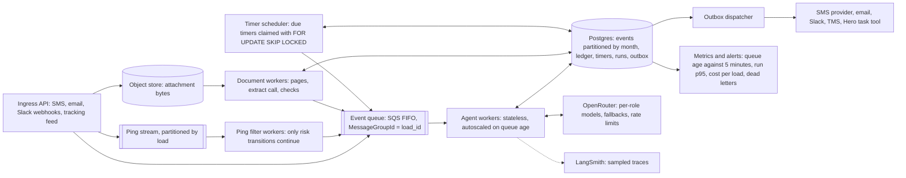

Sizing and the reasons for each piece are in [`answers.md`, 5.2](answers.md#52-volume-x10-what-must-change).
An earlier build of the pgvector search and the operational metrics is at the git tag
`full-platform`.
